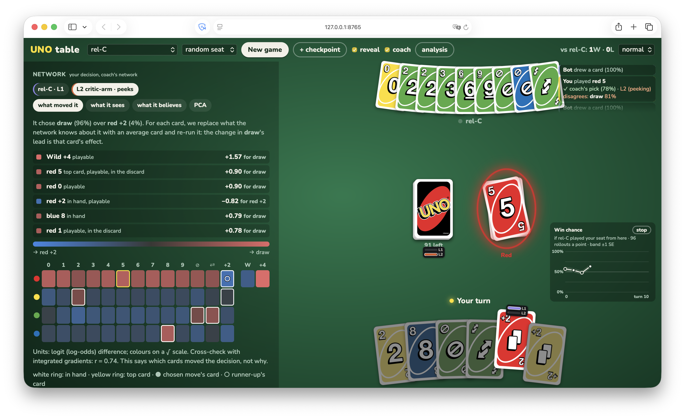
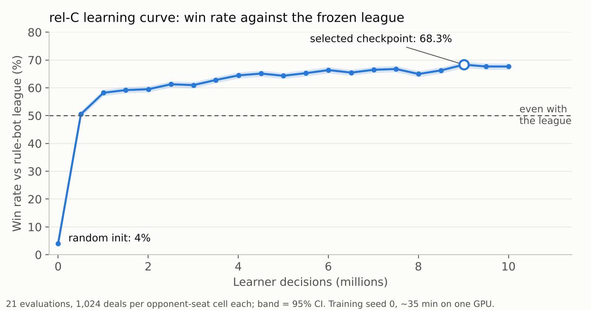

# UNO RL


A reinforcement-learning agent for two-player UNO, built on a game engine whose
solvers are checked against exact game theory, plus a web UI where you play
against the agent and watch why it makes each move.

The trained agent wins **67.7%** of games against a frozen league of rule-based
bots, including **64-67%** against a hand-written heuristic bot, after
10M decisions (495k games) of training in about 35 minutes on one GPU.



## At a glance

| Area | Techniques |
|---|---|
| Reinforcement learning | PPO (clipped, GAE, target-KL early stop, entropy bonus), training against a frozen opponent league, asymmetric actor-critic (the critic sees privileged info the actor can't) |
| Game theory | CFR+ / DCFR / PCFR+ equilibria, best responses and exploitability, symmetry-reduced game trees, PIMC search, AIVAT variance reduction |
| Deep learning | Permutation-equivariant relational network, recurrent variant, bf16 mixed precision, `torch.compile`, CUDA |
| Interpretability | Occlusion, integrated gradients, linear probes (AUROC), per-layer PCA, calibration testing |
| Evaluation | Paired comparisons on shared deals, DEV/EVAL seed partitions, decision rules declared before each run, 95% CIs |
| Engineering | Immutable game engine, vectorized NumPy game trees, slow reference implementations as test oracles, property-based tests, MLflow with config hashes, dependency-free web UI |

## Results



| Agent | Win rate vs league | Notes |
|---|---|---|
| rel-C, final checkpoint | **67.7%** (95% CI 66.5-68.8) | the agent shipped in the UI; 8,192 games |
| rel-C vs the heuristic bot only | 66.9% / 63.9% | moving first / second |
| Heuristic bot (reference) | ~50% | the hand-written bot against the same kind of league |
| Arm B, earlier inputs, longer run | ~49% | 1.2 points below the heuristic reference; earlier panel, not paired with rel-C |
| "Peeking" actor (sees your hand) | 93.4% | an information reference, not a reachable target |

All scores are win probability, `(return + 1) / 2`, averaged over both seats and
over four league bots on the DEV seed partition, for training seed 0. Every
measurement, its configuration and its caveats are in
[`docs/rl/results/`](docs/rl/results/index.md).

## How it works

**1. Architectures validated against exact answers.** UNO is an imperfect-information game, so before
training anything, the project runs exact algorithms on reduced versions of it
(smaller decks, up to 28M game histories, which are exactly solvable). CFR+ computes 
Nash equilibrium strategies, best responses measure how exploitable an agent is,
and a color/rank symmetry reduction shrinks the smallest toy's tree 37x (1.25M histories to 33,646).
These exact answers were used to check the learner's gradients and training loop before it ever saw full UNO. ([foundations](docs/foundations/README.md))

**2. Equivariant network.** The actor reads the game as
54 card tokens (4 colors x 13 ranks + 2 wilds) and is equivariant by
construction: relabeling the colors relabels its output probabilities exactly,
which is checked numerically in the tests. 0.9M parameters, with a separate
critic. ([architecture](uno/rl/model/relational.py),
[observation contract](docs/rl/observation-contract.md))

**3. PPO against a frozen league.** The agent trains against four distinct rule
bots: a heuristic that tracks which colors you lack, two tactical scorers, and a
deliberately unpredictable bot that breaks inference assumptions, to avoid overfitting. Collection runs
12 workers with 64 live games each; updates use bf16 and `torch.compile` on CUDA. Runs
are tracked in MLflow with config and code hashes for provenance.

**4. Careful evaluation.** Comparisons are paired on the same deals and opponent
streams, both seats are always reported, tuning uses a DEV seed range, and
confirmatory claims are reserved for a separate EVAL range. Decision rules are
written down before an experiment runs.

**5. Seeing why the agent plays a card.** The play UI shows, for each bot move:

- **What moved it:** occlusion ranking of the inputs, with integrated gradients
  as a cross-check.
- **What it sees:** any single input channel.
- **What it believes:** a linear probe, per layer, of which cards it thinks you
  hold. It reaches AUROC 0.74 at the last block, on par with a hand-written
  void-tracking belief (0.74).
- **Per-layer PCA** of its activations, as a separate tab.
- **A coach** showing what the agent, and the hand-peeking actor, would play given your hand.

## What I learned

- **Inputs mattered much more than training time.** Arm B plateaued just below the
  heuristic bot even when trained longer. Arm C, which adds the public game
  history, beat it clearly. A feature fix also landed between the two runs, so
  this is not a clean ablation yet.
- **Ablations and iteration speed are king.** The first pilot ran at about 140
  decisions/s on a laptop CPU; after moving to CUDA with bf16 and `torch.compile`,
  the pipeline reached about 4,800/s (new hardware accounts for part of that).
  Faster runs meant more ablations, and the ablations are what pointed to the
  directions that worked.
- **A critic is not a win probability.** The plan was to show the critic as a live
  win-chance curve. A calibration test, declared before running, found bins off by
  up to 0.22 against some opponents, and a per-opponent correction failed on
  held-out games. The UI shows rollout values instead.
  ([result](docs/rl/results/critic-calibration.md))
- **Learned beliefs match the hand-written one, not more.** The probe shows the
  network tracks your hand about as well as the void heuristic the rule bots use,
  no better. My hypothesis, not yet tested: its edge over the bots comes from how it
  uses that belief, not from deducing more from the same information.

## Status and limits

These are DEV results from one training seed; multi-seed runs and a frozen EVAL
report card are next. A recurrent variant (rec-C), which adds an explicit
memory of the game history, is implemented and trained. In my runs it reached a
slightly higher ceiling than rel-C but took several hours to train instead of
about 35 minutes, so rel-C is the one shipped in the UI. Its numbers aren't
written up yet. Current status:
[`docs/rl/README.md`](docs/rl/README.md).

## Quick start

```sh
uv sync                     # Python 3.14; installs the `uno` command
```

### Play against the agent

```sh
# rel-C as the opponent, the peeking actor as your coach
uv run uno play \
  --ckpt uno/play/static/checkpoints/arm_C_relative/checkpoints/best_actor.pt=rel-C \
  --coach uno/play/static/checkpoints/critic_relative/checkpoints/best_actor.pt="L2 critic-arm"
```

The table opens at http://127.0.0.1:8765. Repeat `--ckpt` to add more opponents
(the 4 rule bots are always there). Other options: `--port`, `--rollouts` (per
win-chance point, default 96), `--cards DIR` for card sprites, `--no-browser`.

### Train

```sh
uv run uno rl train pilot                        # a preset from configs/rl/
uv run uno rl train overnight --seed 1           # same preset, another training seed
uv run uno rl train --config my_run.toml         # any config file
uv run uno rl train overnight --set data_cap=10000000 --set optim.entropy_coef=0.003
uv run uno rl resume logs/rl/<run>/checkpoints/latest.pt
```

A preset name is looked up in `configs/rl/local/` (git-ignored, for personal
configs) and then in `configs/rl/`; with no name, `train` uses the local
`experiment` preset. `--set` overrides any field with a dotted path. `resume`
refuses overrides that would change the algorithm (model, objective, optimizer),
so a continued run stays comparable. rel-C's exact settings are in
`uno/play/static/checkpoints/arm_C_relative/tracking/params.json`.

On Windows, run from a shell where MSVC `cl` is on `PATH`, otherwise
`torch.compile` silently falls back to eager mode.

### Track runs

```sh
uv run mlflow ui --backend-store-uri sqlite:///logs/rl/mlflow.db
```

Runs, checkpoints and the MLflow store all live under `logs/rl/` (git-ignored).

### Test

```sh
uv run pytest               # full test suite
uv run pytest tests/rl      # one area
uv run uno list             # every experiment and its arguments
```

Card art is not included: `uno/play/slice_sheet.py` cuts a classic spritesheet
you provide into `uno/play/static/cards/`; without it the UI draws CSS cards.

## Developer reference

About 32k lines of Python with 427 test functions mirroring the packages (`tests/game/`,
`tests/reference/`, ...); shared Hypothesis strategies are in `tests/strategies.py`,
pinned values in `tests/known.py`.

- [`docs/rl/`](docs/rl/README.md): RL status, plan, learner contracts and results.
- [`docs/foundations/`](docs/foundations/README.md): engine specification,
  rationale and exact-toy measurements.
- [`docs/play/plan.md`](docs/play/plan.md): the play UI and its analysis panels.
- [`docs/`](docs/README.md): the complete documentation map.

Every experiment is a module of `uno/experiments/` run through the CLI. Trees and
CFR results are cached in `.cache/` (git-ignored, `uno/store.py`).
`bash scripts/rerun_all.sh` reruns the multi-hour foundation suite and is not a
routine check. Seed-pool ownership and claimed EVAL blocks live in
`uno/eval/seeds.py`. `scripts/plot_learning_curve.py` regenerates the chart above
from a run's exported tracking.

### Code map

| module | what |
|--------|------|
| `uno/game/rules.py` | `Ruleset`, card types, actions, named rulesets (`NAMED`: `TOY`, `TOY_FULL`, `TOY2`, `TOY2_FULL`, `TOY2_SKIP`, `FULL_UNO`, ...) |
| `uno/game/engine.py` | immutable state, `initial_state`, `legal_actions`, `step`, `returns` |
| `uno/game/observe.py` | L1 / L2 / L3 observations, `observation_from_key` |
| `uno/game/keys.py` | information-set keys per level and their byte encoding |
| `uno/game/chance.py` | the chance model: lazy-chance children, deals, worlds, pile decomposition |
| `uno/game/symmetry.py` | color / rank symmetry group, canonical keys, orbit representatives ([spec section 18](docs/foundations/spec.md)) |
| `uno/agents/baseline.py` | `UniformLegal`, `PlayFirstRandom` (the "Random" row), `Heuristic`, `BySeat` |
| `uno/agents/rulebot.py` | the league: `MemoryHeuristic`, `TransferRuleBot`, `DistilledRuleBot`, `UnpredictableRuleBot` |
| `uno/agents/tabular.py` | `TabularAgent`, `PureStrategy`, `CompiledAgent`: agents that play a table |
| `uno/agents/symmetrized.py` | `Symmetrized`: any agent made symmetric, so it can be evaluated on the quotient tree |
| `uno/reference/` | pure-Python reference walkers (slow, trusted): `census`, `solve` (evaluate, best response), `mirrored` (exact moments), `sizing` (position DP) |
| `uno/compiled/tree.py` | the tree as numpy arrays (quotient under the symmetry by default), keyings, `compile_tree` |
| `uno/compiled/solvers.py` | fast `evaluate`, `best_response`, `best_response_perfect`, `exploitability`, `exact_mirrored` |
| `uno/compiled/strategies.py` | `tabulate`, `tabulate_table`, `br_row` (a best-response row with a fill-in for unreached sets) |
| `uno/compiled/cfr.py` | CFR+ / vanilla / DCFR / PCFR+ on the compiled tree |
| `uno/eval/play.py` | `play_game`, `match` (common random numbers), seed ranges |
| `uno/eval/estimate.py` | `play_pairs`, `estimate_mirrored`, `compare`, statistics |
| `uno/rl/` | learner features, models (`relational`, `recurrent`), collection, PPO, checkpoints, tracking |
| `uno/play/` | play server, opponents, rollout analysis, network inspection, critic calibration |
| `uno/store.py` | the cache: `load_or_compile`, `load_nash`, `load_or_solve_nash` |
| `uno/experiments/` | one module per step experiment, `common.py` for shared helpers; `uno/cli.py` runs them |

### Quick examples

Sampled match (score of the first agent, seat 0):

```python
from uno import TOY
from uno.agents.baseline import Heuristic, PlayFirstRandom
from uno.eval.play import match

print(match(TOY, (Heuristic(TOY), PlayFirstRandom(TOY)), range(1000)))
```

Exact exploitability of an agent (~2 s on the quotient tree; `symmetric=False` gives the full tree, ~15 s):

```python
from uno import TOY, Level
from uno.agents.baseline import Heuristic
from uno.compiled.solvers import exploitability
from uno.compiled.strategies import tabulate
from uno.store import load_or_compile

tree = load_or_compile(TOY)
sigma = tabulate(tree, Level.L1, Heuristic(TOY))
print(exploitability(tree, Level.L1, sigma))
```